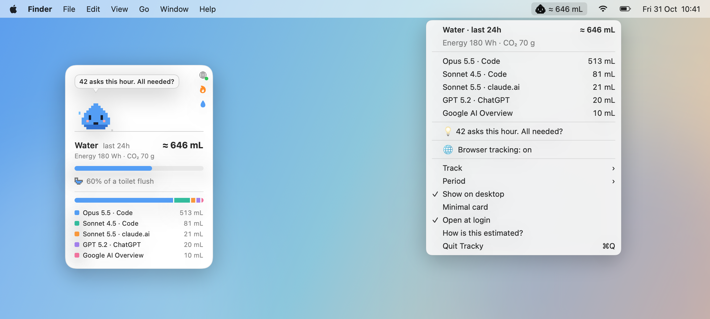
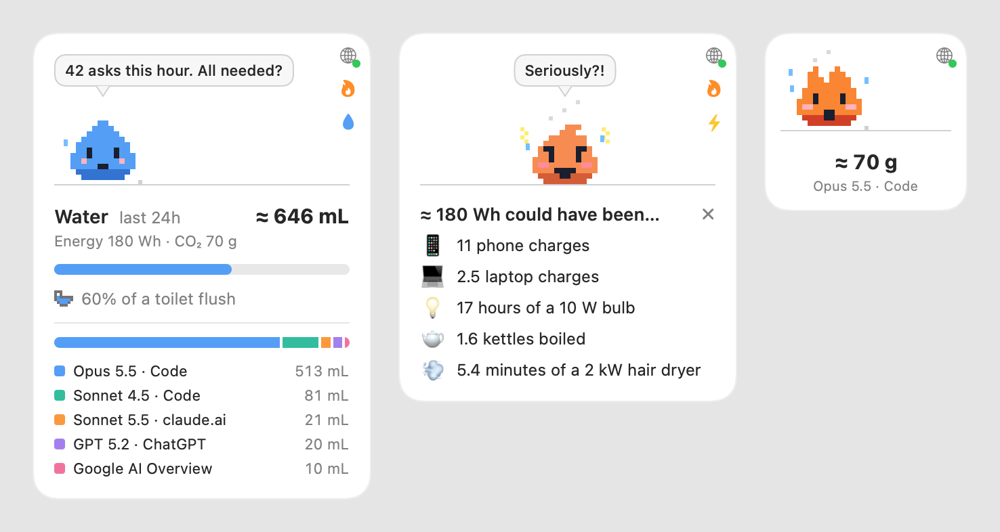

<p align="center">
  
</p>

<h1 align="center">Tracky</h1>

<p align="center">A pixel companion for your Mac that shows the water, energy and CO₂ behind your AI use.</p>

<p align="center">
  <a href="https://github.com/andreagemelli/tracky/actions/workflows/ci.yml"></a>
  <a href="https://github.com/andreagemelli/tracky/releases/latest"></a>
  
  <a href="LICENSE"></a>
</p>

## Introduction

Tracky lives in your menu bar and on your desktop, and shows what your AI use costs while you use it: **water, energy and CO₂**. It reads the logs AI tools already keep on your Mac, turns each reply into an estimate, and heats up as the total grows. Along the way it nudges you toward lighter choices: a smaller or local model, lower effort, or no AI at all when a search would do. Nothing leaves your Mac.

Estimates use the open [EcoLogits](https://ecologits.ai) method by GenAI Impact, ported to Swift and checked against the Python library.



> [!NOTE]
> **Work in progress.** Tracky is young, and some measurements may still be imprecise: closed models don't publish their sizes, browser token counts are estimated from reply length, and local power uses one Mac's measurement. Treat the numbers as informed estimates. Contributions are more than welcome: issues, fixes, new sources, better data. See [What's been tested](#whats-been-tested) for where things stand. Check [Credits](#credits) section for methods and authors' attributions.

## Quickstart

### Install

Needs macOS 14+ and the Xcode Command Line Tools.

```bash
git clone https://github.com/andreagemelli/tracky && cd tracky && ./build.sh
```

```bash
open build/Tracky.app
```

Tracky appears in the menu bar and as a card on your desktop, and opens at login from then on. Out of the box it tracks local tools:

- **Claude Code**, in the terminal and in the Claude desktop app's Code tab.
- **llama.cpp**, when `llama-server` runs with `--metrics` on its default port.

### Browser tracking (optional, Chrome only)

Click the 🌐 globe on the card (red means off) and follow the two steps:

1. **Connect Chrome.**
2. **Add the extension:** Tracky opens Chrome's extensions page and the extension folder. Turn on *Developer mode*, click *Load unpacked*, and pick that folder.

The dot turns green once the extension checks in. It then counts AI replies on claude.ai, ChatGPT, Gemini, Qwen, Z.ai and other AI chat sites, plus Google's AI Overviews and AI Mode.

## What you can do



- **Pick a metric.** The button under the 🔥 flame switches water → energy → CO₂, and so does *Track* in the menu. Tracky becomes a drop, a spark or a little fire; the other two metrics show under the total.
- **Watch it heat up.** A bar fills toward the next everyday amount, such as a cup, a phone charge or 1 km by car. Each one you pass makes Tracky hotter, until it's red.
- **See where it comes from.** The legend splits the total by model and source, such as *Opus 5.5 · Code* or *GPT 5.2 · ChatGPT*, in at most five lines.
- **Get nudges** in a speech bubble, based on what you've been doing: *do you really need AI for this?* after a burst of asks or a string of quick questions, a plain search instead of Google's AI answers, and always a smaller or local model when it's actually lighter.
- **🔥 Roast me.** Tracky gets angry and lists what the same amount could have been: espressos, phone charges, meters by car… Close it with ✕.
- **Go minimal.** Double-click the card for just Tracky, the total and the model that used the most.

The menu bar has the same breakdown, plus the period (last 1, 5 or 24 hours) and switches to hide the card or stop opening at login.

## Details

### What's been tested

Tracky may work with more than this, but only what's marked *tested* has been checked against real use.

| Source | How Tracky sees it | Status |
|---|---|---|
| Claude Code | its local logs: exact model and token counts | tested |
| llama.cpp | its metrics: exact tokens and generation time | tested |
| claude.ai, ChatGPT, Qwen, Z.ai, Google AI Overviews and AI Mode (Chrome) | the extension | tested |
| Gemini, DeepSeek, Le Chat, Perplexity, Grok, Kimi, Copilot, HuggingChat, Poe (Chrome) | the extension | built, not confirmed |
| Ollama, Claude desktop chat, Cowork, other desktop apps, Firefox, Safari | — | not yet |

### How it's estimated

- **Cloud models:** [EcoLogits](https://ecologits.ai/latest/methodology/llm_inference/) v0.11.3. Energy comes from output tokens and the model's active parameters, scaled by the data center's PUE. CO₂ is that energy × the data-center grid's carbon intensity, plus the request's share of manufacturing the servers and GPUs (EcoLogits' embodied impact, over a 3-year life). Water follows [Li et al. 2025](https://arxiv.org/abs/2304.03271): cooling water plus the water used to make the electricity. Closed models don't publish their sizes, so EcoLogits estimates a range; Tracky shows its midpoint, marked `≈`.
- **Google** (Gemini, AI Overviews): Google's [own measurement](https://services.google.com/fh/files/misc/measuring_the_environmental_impact_of_delivering_ai_at_google_scale.pdf) of a median prompt: 0.24 Wh, 0.03 g CO₂e, 0.26 mL.
- **Models EcoLogits doesn't know** (Qwen, DeepSeek…): the same formula with a wide assumed size range. Treat these as an order of magnitude.
- **Local models:** generation time × the Mac's extra power while generating, on your region's grid. The 19.2 W figure was measured on a MacBook Pro M4 (23.2 W generating, 4.0 W idle) and is used for every Mac for now.
- **Browser replies:** about 4 characters per token, counted only once a reply has been seen streaming in.

For scale, 1,000 output tokens from Opus 5.5 are about 3.1–5.9 Wh, 1.3–2.3 g CO₂e and 10–24 mL of water; from Haiku 5.5, about 40× less.

**Local vs cloud:** a laptop isn't always lighter. Per token, batched data-center GPUs can beat a Mac on energy for small models like Haiku, while a local model saves the data center's cooling water. Tracky suggests going local only when its numbers say so.

**Limits:** only output tokens count, so long agent sessions (mostly cached context) are underestimated. Training isn't included, and neither is the Mac's own manufacturing for local models.

### Everyday amounts

| | Water | Energy | CO₂ (by car¹) |
|---|---|---|---|
| 1 | a cup, 0.25 L | a phone charge, 15 Wh | 100 m |
| 2 | a bottle, 1.5 L | a laptop charge, 72.4 Wh² | 1 km |
| 3 | a toilet flush, 6 L³ | a kettle, 0.11 kWh⁴ | 5 km |
| 4 | a bucket, 10 L | a hot shower, 1.74 kWh⁵ | 20 km |
| 5 | a shower, 60 L⁶ | a home's day, 7.4 kWh⁷ | 100 km |
| 6 | a bathtub, 150 L | a home's week, 52 kWh⁷ | 500 km |

¹ Average car, unknown fuel, 0.16691 kg CO₂e/km ([UK government 2024](https://www.gov.uk/government/publications/greenhouse-gas-reporting-conversion-factors-2024)). ² MacBook Pro 14" battery. ³ [US limit, 1.6 gal](https://www.epa.gov/watersense/residential-toilets). ⁴ Boiling 1 L from 20 °C at ~85% efficiency. ⁵ Warming 60 L by 25 °C. ⁶ [Average US shower](https://home-water-works.org/indoor-use/showers). ⁷ 2,700 kWh a year, the [typical Italian household](https://bolletta-energia.it/luce/consumi). The roast's tomato uses a global average of [214 L per kg](https://www.enel.com/learning-hub/environment/water-footprint).

### Privacy

Tracky stores only which model ran, when, and how many tokens it produced; never prompts or replies. Its only network request goes to a llama.cpp server on your own Mac. The browser extension sends Tracky the site, the model and a token count, never the text. Browser and local events are kept in `~/Library/Application Support/Tracky/`.

### For developers

```bash
build/Tracky.app/Contents/MacOS/Tracky --selftest
```

`--selftest` runs the checks (also run by `build.sh`), `--dump` prints what Tracky read in the last 24 hours, and `--shots docs` renders the README screenshots.

## Credits

- [EcoLogits](https://github.com/mlco2/ecologits) by GenAI Impact: the code Tracky ports and `Resources/models.json` (MPL-2.0), and the [methodology](https://ecologits.ai/latest/methodology/) behind every cloud estimate (CC BY-SA 4.0). Tracky describes it in its own words. Please cite their paper: Samuel Rincé and Adrien Banse, [*EcoLogits: Evaluating the Environmental Impacts of Generative AI*](https://doi.org/10.21105/joss.07471), Journal of Open Source Software 10(111), 7471, 2025.
- Data behind EcoLogits' numbers, used through it: [Our World in Data](https://ourworldindata.org) (grid CO₂), [ADEME](https://base-empreinte.ademe.fr), [World Resources Institute](https://www.wri.org) (water used to make electricity), [ML.ENERGY](https://ml.energy/leaderboard), [OpenRouter](https://openrouter.ai), [Boavizta](https://boavizta.org) and providers' published PUE and WUE.
- [claude-mascot](https://github.com/No-one9/claude-mascot) (MIT): inspiration for the card and the pixel mascot; `build.sh` is adapted from its build script and carries its MIT notice.
- Related: [Drippy](https://github.com/trnprnc/Drippy), a menu-bar meter for the energy and water behind Claude Code.

## License

Free for personal, research and other noncommercial use, under the [PolyForm Noncommercial License 1.0.0](LICENSE): you can use, change and share Tracky, but not make money with it. Two files come from EcoLogits and stay under the [Mozilla Public License 2.0](LICENSE-MPL-2.0): `Sources/Water.swift` (the port of its method) and `Resources/models.json`. The grid factors in `Sources/Local.swift` are taken from EcoLogits' `electricity_mixes.json`.
