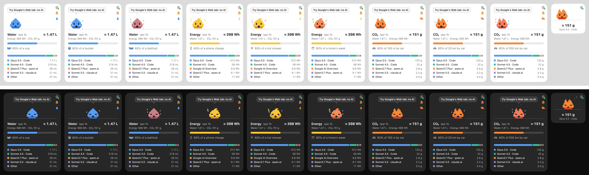

# Tracky

A small pixel companion that lives on your Mac and shows what your AI use costs, while you use it: water, energy and CO₂. It works locally out of the box, reading the logs AI tools already keep on your Mac. Browser tracking (AI chats and Google's AI answers) is an optional add-on.



- **Pick what Tracky tracks:** water, energy or CO₂, with the button under the flame (each click switches to the next) or from *Track* in the menu. Tracky becomes a 💧 drop, a ⚡ spark or a 🔥 little fire, and the meter, the ladder and the roast follow. The other two are reported on the line under the total.
- **On the desktop:** a card you can drag anywhere. Tracky sleeps when no AI is working and paces and hops while one is. Double-click the card (or use the menu) to switch between the complete card and a minimal one with just Tracky, the total and the model that used the most.
- **It heats up as you use more.** A bar fills toward the next everyday amount, and each one you pass makes Tracky hotter: happy, blushing, sweating, flushed and panting, steaming, then overheated and red.

  | | Water | Energy | CO₂ (by car¹) |
  |---|---|---|---|
  | 1 | a cup, 0.25 L | a phone charge, 15 Wh | 100 m |
  | 2 | a bottle, 1.5 L | a laptop charge, 72.4 Wh² | 1 km |
  | 3 | a toilet flush, 6 L³ | a kettle, 0.11 kWh⁴ | 5 km |
  | 4 | a bucket, 10 L | a hot shower, 1.74 kWh⁵ | 20 km |
  | 5 | a shower, 60 L⁶ | a home's day, 7.4 kWh⁷ | 100 km |
  | 6 | a bathtub, 150 L | a home's week, 52 kWh⁷ | 500 km |

  ¹ Average car, unknown fuel: 0.16691 kg CO₂e per km ([UK government conversion factors 2024](https://www.gov.uk/government/publications/greenhouse-gas-reporting-conversion-factors-2024)). ² MacBook Pro 14" battery. ³ [US limit, 1.6 gal](https://www.epa.gov/watersense/residential-toilets). ⁴ Boiling 1 L from 20 °C, 0.093 kWh of heat at ~85% efficiency. ⁵ Warming 60 L by 25 °C. ⁶ [Average US shower, 15.8 gal](https://home-water-works.org/indoor-use/showers). ⁷ 2,700 kWh a year, the [typical Italian household](https://bolletta-energia.it/luce/consumi) used by the energy regulator ARERA.

- **Where it comes from:** a second bar splits the total by model and source, such as *Opus 5.5 · Code*, *GPT 5.2 · ChatGPT* or *Google AI Overview*, with a legend of at most five lines. With more than five, the four largest stay and the rest are summed as *Other*. The menu shows the same lines.
- **Tips in a speech bubble,** about what you used last: the next lighter model in the same family (*Try Sonnet 5.5: ~3× less water* after Opus), your coding agent's effort (*45% thinking: try lower effort*), or, after a Google search with an AI answer, *Try Google's Web tab: no AI*.
- **🔥 Roast me:** click the flame under the globe and Tracky gets angry, listing what the same amount could have been. For water: espressos, cups of tea, seconds of shower, toilet flushes, tomatoes grown (a global average of [214 L per kg](https://www.enel.com/learning-hub/environment/water-footprint), Hoekstra & Chapagain 2007). For energy: phone and laptop charges, hours of a 10 W bulb, kettles boiled, minutes of a 2 kW hair dryer. For CO₂: meters by car, and the same household uses on your region's grid. Close it with ✕. It's on the complete card only.
- **Browser tracking, at a glance:** a globe in the card's corner with a red dot when it's off and a green one when it's on. Click it to set it up in two steps (on the minimal card the globe only shows the status).
- **Menu bar:** Tracky and the total. Click it for the other two metrics, the same breakdown, a tip, *Track* (water, energy or CO₂), the period (last 1, 5 or 24 hours), switches for the minimal card, to hide the card and to open Tracky at login (on by default), and *How is this estimated?*, which opens the EcoLogits method Tracky implements.

Everything stays on your Mac. Tracky records only which model ran, when, and how many tokens it produced. It never stores prompts or replies, needs no macOS permissions, and nothing leaves your Mac: its only network request is to a llama.cpp server on your own Mac, if one is running.

## What works, and what's been tested

Tracky may work with tools outside this list, but only what's marked *tested* has been checked against real use.

| Source | How Tracky sees it | Status |
|---|---|---|
| Claude Code (terminal, and the Claude desktop app's Code tab) | its local logs: exact model and token counts | tested |
| llama.cpp (`llama-server --metrics` on the default port 8080) | its metrics: exact tokens and generation time | tested |
| claude.ai in Chrome | extension, model from the page | tested |
| chatgpt.com in Chrome | extension, model from the page when shown (GPT-5 otherwise) | tested |
| Google AI Overviews and AI Mode in Chrome | extension, one prompt per AI answer, follow-ups included | tested (English and Italian Google) |
| gemini.google.com in Chrome | extension | built, not confirmed |
| Qwen and Z.ai in Chrome | extension's general meter | tested |
| Other AI chat sites in Chrome: DeepSeek, Le Chat, Perplexity, Grok, Kimi, Copilot, HuggingChat, Poe | extension's general meter | built, not confirmed |
| Ollama, Claude desktop app's chat, Cowork, desktop chat apps, Firefox, Safari | — | not yet |

## Install

Needs macOS 14+ and the Swift toolchain (Xcode Command Line Tools are enough).

```bash
./build.sh
```

```bash
open build/Tracky.app
```

`build.sh` also runs the self-tests. Two more flags help with checking:

```bash
build/Tracky.app/Contents/MacOS/Tracky --dump
```

```bash
build/Tracky.app/Contents/MacOS/Tracky --preview docs/preview.png
```

`--dump` prints what Tracky read from the last 24 hours. `--preview` renders every heat level, awake and asleep, to a PNG, adding a few sample browser events so the legend fills up.

### Browser tracking (optional, Chrome)

Click the globe on Tracky's card, or *Browser tracking* in the menu, and follow the two steps:

1. **Connect Chrome:** registers Tracky as Chrome's [native messaging](https://developer.chrome.com/docs/extensions/develop/concepts/native-messaging) host, so the extension can reach it.
2. **Add the extension:** opens Chrome's extensions page and the extension folder bundled in Tracky. Turn on **Developer mode**, click **Load unpacked**, and pick that folder.

The dot turns green once the extension checks in. *Turn off* in the same box removes the link.

## How it sees your AI use

**Local tools.** Tracky reads Claude Code's own logs (`~/.claude/projects/*/*.jsonl`): for each reply, the model, output and thinking tokens, and effort. These counts are exact.

**Local models (llama.cpp).** Start the server with `--metrics` and Tracky reads its counters every 10 seconds: new output tokens and the seconds spent generating, with the model's file name. Each stretch of generation is stored as one line in `~/Library/Application Support/Tracky/local.jsonl`. If the server was already running when Tracky started, only what comes after counts.

**The browser (optional).** When an AI reply finishes, the extension sends Tracky the site, the model and an approximate token count, never the text. Tracky stores each event as one line in `~/Library/Application Support/Tracky/browser.jsonl`. There are two ways it notices replies:

- **Dedicated watchers** for claude.ai, ChatGPT, Gemini and Google search. They read each site's page structure, which also gives the model name. Sites can change that structure without notice.
- **A general meter** for the other listed sites. It notices that the page is streaming a reply (a request whose answer arrives in pieces), then measures how much visible text the page gained. It never reads what is sent or streamed, only the model name when the request carries one. Adding a site is one line in `extension/manifest.json`.

Browser token counts are estimates (about 4 characters per token). A reply counts only once Tracky has seen it stream in, so an old chat you open is never counted. If a site stops counting, open its DevTools console: every counted reply logs a `[tracky]` line.

## How the water is estimated

Tracky is a Swift port of the [EcoLogits](https://ecologits.ai) LLM inference method (v0.11.3), checked by `--selftest` against the Python library's own output for energy, CO₂ and water.

1. **Energy per request** comes from the number of output tokens and the model's active parameters, fitted on the [ML.ENERGY leaderboard](https://ml.energy/leaderboard) (GPU), plus the server's share during generation, scaled by the data center's PUE.
2. **Water** follows [Li et al. 2025, *Making AI Less "Thirsty"*](https://arxiv.org/abs/2304.03271): on-site cooling water (the data center's WUE) plus off-site water used to generate its electricity ([WRI method](https://www.wri.org/research/guidance-calculating-water-use-embedded-purchased-electricity)).
   `water = IT energy × (WUE on-site + PUE × WUE off-site)`
3. **CO₂** is the request's energy × the carbon intensity of the data-center country's grid (kg CO₂e per kWh, from EcoLogits' electricity data). It covers running the model only, not manufacturing the hardware.
4. **Model sizes** come from EcoLogits' `models.json`, bundled unchanged in `Resources/`. Closed models (Claude, GPT) don't publish their sizes, so EcoLogits estimates a range. Tracky computes the min–max range and shows its midpoint, marked `≈`.

Three cases go beyond EcoLogits:

- **Google** (Gemini and AI Overviews): Tracky uses Google's own measurement for a [median Gemini text prompt](https://services.google.com/fh/files/misc/measuring_the_environmental_impact_of_delivering_ai_at_google_scale.pdf): 0.24 Wh, 0.03 g CO₂e and 0.26 mL of water.
- **Models EcoLogits doesn't know** (Qwen, DeepSeek, Kimi, Grok and others): the same formula with an assumed size range of 200–1,000B total and 20–100B active parameters, the widest data-center figures EcoLogits uses, and world-average electricity water. Treat these numbers as an order of magnitude.
- **Local models** run on your Mac, so there's no data center: energy is generation time × the Mac's extra power while generating, and CO₂ and water are that energy × your region's grid (picked from your Mac's region setting, from EcoLogits' electricity data; in Italy 0.285 kg CO₂e and 4.84 L per kWh, world average otherwise). The extra power was measured on a MacBook Pro M4 with battery telemetry: 23.2 W generating versus 4.0 W idle, so 19.2 W. A 400-token reply from a 350M model takes about 2 seconds: about 0.01 Wh, 0.003 g CO₂e and 0.05 mL of water. The same figure is used for every model and Mac for now; bigger models draw more.

For scale, by EcoLogits, 1,000 output tokens from Opus 5.5 cost about 3.1–5.9 Wh, 1.2–2.3 g CO₂e and 10–24 mL of water; from Haiku 5.5, about 0.06–0.15 Wh, 0.02–0.06 g and 0.2–0.6 mL.

### Known limits

- **Only output tokens count.** Like EcoLogits, Tracky ignores input. In agent sessions most tokens are re-reads of cached context, so long sessions are underestimated.
- Training and hardware manufacturing are not included; EcoLogits doesn't model water for those.

## Credits

- [EcoLogits](https://github.com/genai-impact/ecologits) by GenAI Impact: method and `Resources/models.json` (MPL-2.0).
- [claude-mascot](https://github.com/No-one9/claude-mascot) (MIT): inspiration for the card, the pixel mascot and the no-Xcode build.
- Related: [Drippy](https://github.com/trnprnc/Drippy), a menu-bar meter of the energy and water behind Claude Code.
